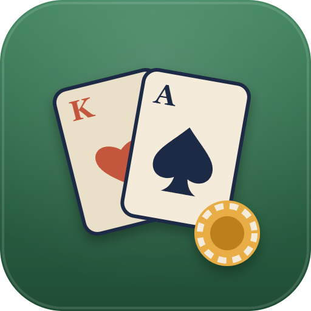
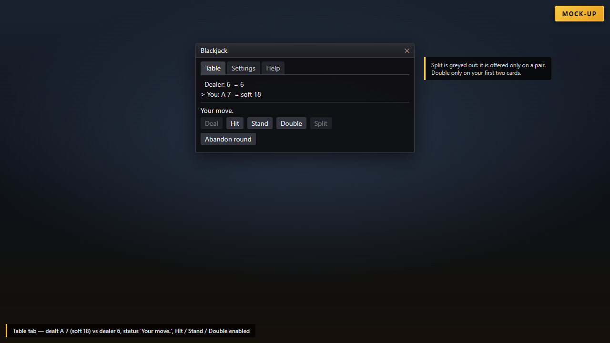
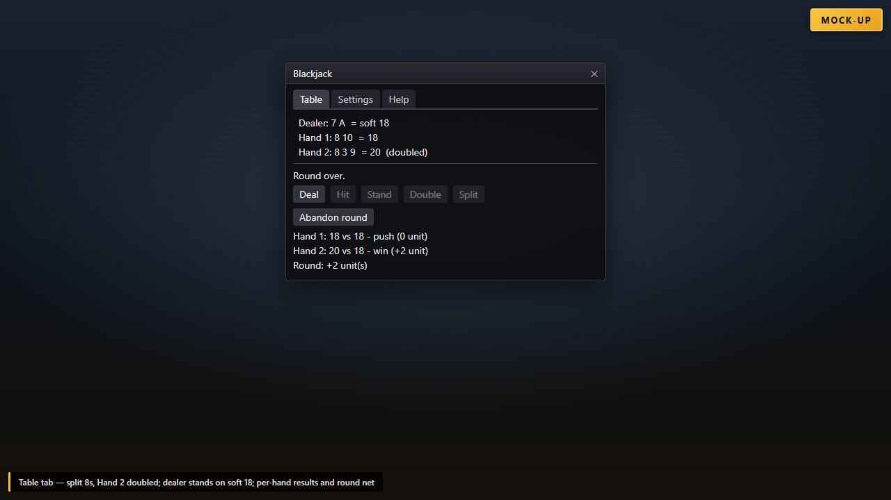
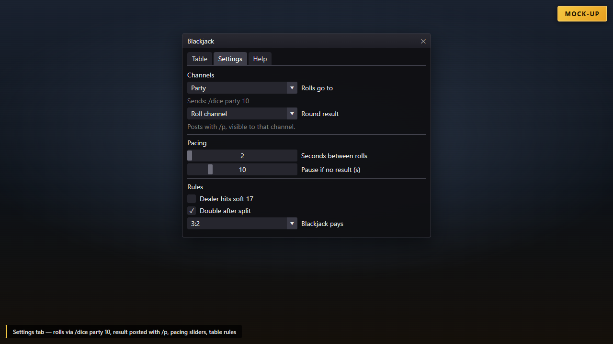
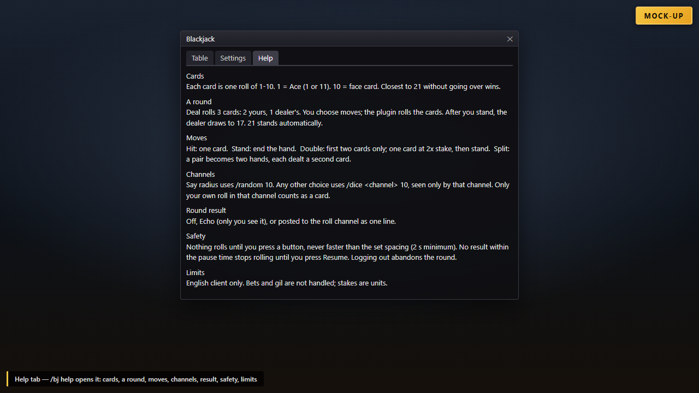
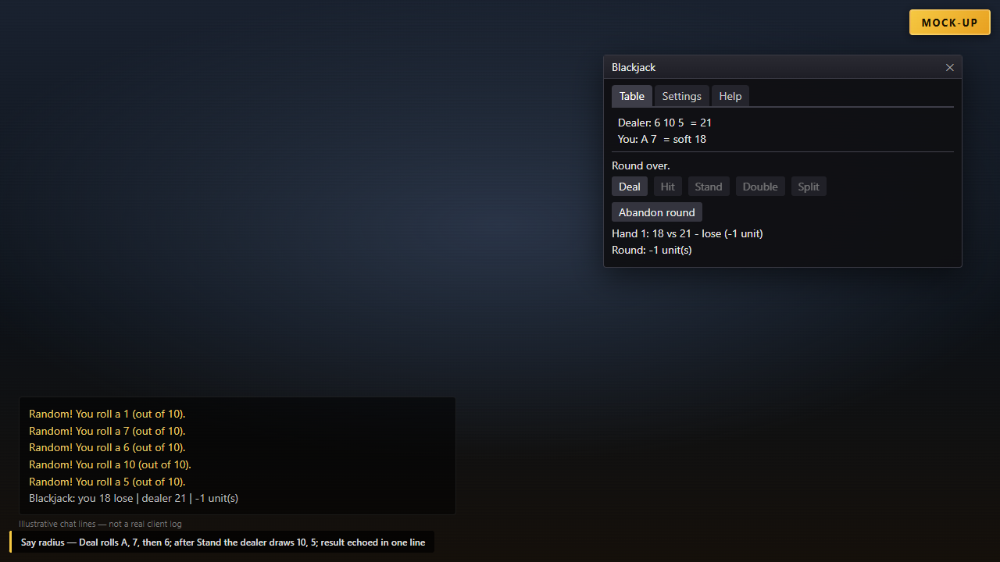
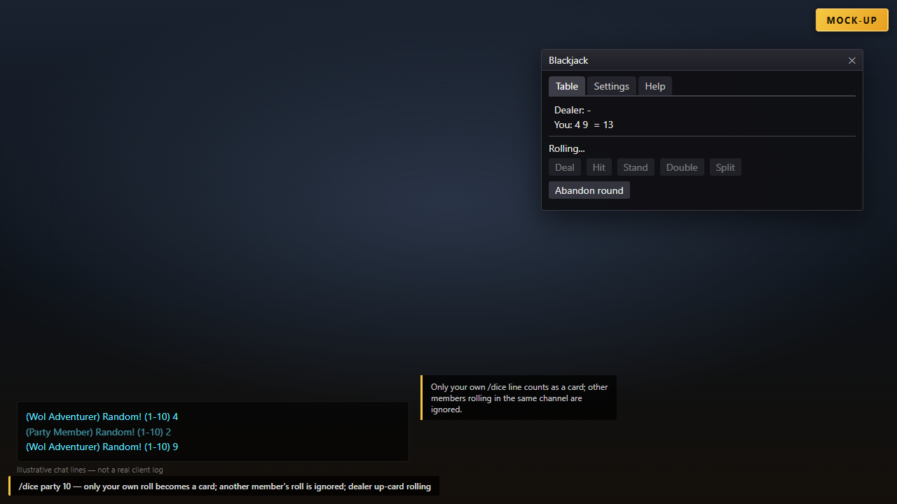

# Blackjack14



Player-run blackjack in FFXIV, played with `/random 10` or `/dice <channel> 10`. The plugin rolls your cards, totals them, plays the dealer and settles the round. All you do is choose each move.

`/bj` · Dalamud API 15 · .NET 10

> **No support will be provided. This software is to be used as is, without warranty of any kind.**

## Screenshots

These images are **mock-ups** (HTML rendered to PNG). They are not real in-game captures and do not show the actual FFXIV client UI.

| | |
| --- | --- |
|  | **Your move** — Table tab after the deal: A 7 (soft 18) against the dealer's 6, with Hit, Stand and Double enabled. |
|  | **Split, double and settle** — two hands from a pair of 8s, Hand 2 doubled, dealer stands on soft 18, with per-hand results and the round net. |
|  | **Settings** — rolls sent with `/dice party 10`, the result posted with `/p`, the pacing sliders and the table rules. |
|  | **Help** — the tab `/bj help` opens: cards, a round, moves, channels, result, safety and limits. |
|  | **`/random 10` in the say radius** — each `Random! You roll a N (out of 10).` line becomes a card, and the round result is echoed as one line. |
|  | **`/dice party 10`** — only your own roll counts as a card; another party member's roll is ignored. |

## What it does

- **Deals for you.** **Deal** rolls three times: two cards for you, then the dealer's up-card.
- **Rolls in the channel you pick.** The say radius uses `/random 10`. Party, Alliance, Free Company, PvP Team, Linkshell 1-8 and Cross-world Linkshell 1-8 use `/dice <channel> 10`, so only that channel sees the roll.
- **Reads the rolls back from chat.** Each result line of yours becomes a card. A roll of 1 is an Ace and counts 1 or 11, whichever is better. A roll of 10 is a face card.
- **Your moves are buttons.** **Hit** draws one card. **Stand** ends the hand. **Double** is offered only on your first two cards: it draws exactly one card at double stake and then stands. **Split** is offered only on a pair: it makes two hands, and each gets its next card rolled automatically.
- **Plays the dealer.** Once you stand, the dealer draws until reaching 17 or more. Whether the dealer hits a soft 17 is a setting. If every one of your hands has bust, the dealer rolls nothing.
- **Settles in units and reports the result.** Each hand is scored win, lose or push at 1 unit, or 2 units if doubled. A natural (two-card 21) pays 3:2 by default and pushes against a dealer natural. The round result is shown as one line, wherever you choose: Echo, the roll channel, or nowhere. A 21 made after a split counts as an ordinary 21, not a natural.

### What it is not meant to do

- **It does not roll by itself.** Nothing is rolled until you press Deal, Hit, Double or Split. One press rolls only the cards that move needs, and nothing is sent more often than once every 2 seconds.
- **It does not retry.** If no result appears within the pause time, rolling pauses until you press **Resume rolling**. It never re-sends a roll on its own.
- **It does not handle gil, bets or trades.** Stakes are counted in units, and paying out is up to you.
- **It does not read anyone else's rolls.** Only your own results count as cards, even in a channel where others are rolling.
- **It does not choose your moves.** There is no strategy advice and no auto-play for your hand.

## How it works

| Piece | Mechanism |
| --- | --- |
| Sending | Calls `UIModule.ProcessChatBoxEntry` from FFXIVClientStructs on the framework thread. No signature of its own, no hook. Only plugin-built text is sent: the roll command, or the summary line, which must be a single line of 400 characters or fewer and must not start with `/`. |
| `/random` read | `XivChatType.RandomNumber` (74), `^Random! You roll a (\d+) \(out of 10\)\.$`. |
| `/dice` read | Only the chat types of the chosen channel (Party also accepts CrossParty), `^Random! \(1-10\) (\d+)$`, and the sender must be your character's name. |
| Gate | A result counts only while one of the plugin's own rolls is waiting for an answer. A roll you type yourself while idle changes nothing. |
| Pace | Every send is at least the set spacing apart (2 s minimum). After the pause time with no result, rolling stops. Logging out abandons the round. |

Two plugins (GamblePyon, ChatDeathRoll2) agree on both result formats. The `/dice` chat-mode words come from the Lodestone `/dice` entry. All round logic lives in `BlackjackGame.cs` and `Channels.cs`, neither of which depends on Dalamud.

## Commands

| Command | Effect |
| --- | --- |
| `/bj` | Open or close the table window. |
| `/bj config` | Open the Settings tab. |
| `/bj help` | Open the Help tab. |

## Settings

Settings are locked while a round is in play.

- **Rolls go to:** the say radius (`/random`, default), Party, Alliance, Free Company, PvP Team, Linkshell 1-8 or Cross-world Linkshell 1-8 (`/dice`).
- **Round result:** Off, Echo (default; only you see it), or posted to the roll channel with its chat prefix (`/s`, `/p`, `/l1`, ...).
- **Seconds between rolls:** 2-10, default 2.
- **Pause if no result:** 5-30 s, default 10.
- **Rules:** dealer hits soft 17 (default off); double after split (default on); blackjack pays 3:2 (default), 6:5, 2:1 or 1:1.
- **Help tab:** one short paragraph each on cards, a round, moves, channels, the result line, safety and limits.

## Build

Requires the .NET 10 SDK and the Dalamud dev distribution
(`%APPDATA%\XIVLauncher\addon\Hooks\dev`, or `DALAMUD_HOME`).

```
dotnet build -c Debug      # load bin/Debug/Blackjack14.dll as a dev plugin
dotnet build -c Release    # zip in bin/Release/Blackjack14/latest.zip
```

## Install

Add `https://raw.githubusercontent.com/priestkos/PlogonYes/main/pluginmaster.json` under `/xlsettings` → Experimental → Custom Plugin Repositories, then install **Blackjack14** from `/xlplugins`.

## Install (dev plugin)

1. `/xlsettings` → Experimental → Dev Plugin Locations → add `bin\Debug\Blackjack14.dll`.
2. `/xlplugins` → Dev Tools → enable **Blackjack14**.
3. `/bj` opens the table.

## Tests

The xUnit project compiles `BlackjackGame.cs` on its own, without Dalamud. It covers ace totals, both roll parsers (they accept only d10 results), every channel's roll command and chat prefix, matching the sender's name exactly, the send guard on the summary line, the three rule settings, the deal order, refusing unexpected rolls, bust, the dealer drawing to 17 including soft 17, double, naturals, and split. It also plays 20,000 random rounds to prove every round ends within a bounded number of rolls.

```
dotnet test Blackjack14.Tests    # 48 tests
```

## Limits

- **Not verified in game.** This description comes from the code and the offline tests, not from a live client.
- **English client only.** The roll regexes match the English messages, so on JP, DE or FR clients no roll is recognised and rolling pauses.
- **Not verified in game:** the chat type a `/dice` line arrives with, and the exact form of your own name as the sender. Both come from reading other plugins' code. If either is wrong, rolls in that channel never register and rolling pauses: it fails safe, not wrong.
- **`/random` is visible to nearby players** in the /say radius. That is how the game works, and the plugin does not change it.
- **Echo results need the Echo chat filter ticked** in your chat log tab.
- **One split per round, and no re-split.** Split aces play on like any other split hand.
- **A very late result can be misread.** If a result arrives after the 10 s pause *and* after you press Resume, it can be taken as the next card.

## Layout

```
Blackjack14Plugin.cs    entry point: services, /bj, pacing, chat read, announce, send
BlackjackGame.cs        pure round logic: rules, hands, totals, moves, dealer, settlement, summary, roll parsers
Channels.cs             pure channel text: roll command, chat prefix, labels, sender match, send guard
Configuration.cs        saved settings and their ranges
BlackjackWindow.cs      Table / Settings / Help tabs
Blackjack14.Tests/      xUnit tests over BlackjackGame.cs and Channels.cs
images/                 icon.svg (source) and icon.png (manifest icon)
docs/screenshots/       mock-up screenshots used in this README
.github/workflows/      build.yml (build + tests on every push), release.yml (tests, build, release on main)
```
